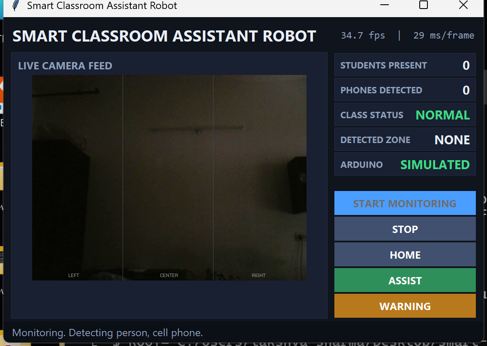

# Smart Classroom Assistant Robot

A laptop watches the classroom with YOLO, a Tkinter dashboard shows what it sees,
and an Arduino Uno drives a 4-DOF arm that points at what triggered an alert or
fetches a marker on request.

```
WEBCAM → COMPUTER VISION → DECISION LOGIC → DASHBOARD → USB SERIAL → ARDUINO → SERVOS → ARM
```



## Status: software complete, hardware not yet attached

Every software phase is built and tested. **No Arduino has ever been connected**,
so nothing below claims the servos have moved.

| Phase | What it does | Verified how |
|---|---|---|
| 0 Environment | venv, four packages, webcam + serial check | 9 checks, `check_setup.py` |
| 1 Arduino sketch | 4 servos, 8 presets, safe limits, serial protocol | **31 checks** — compiled with g++ and executed on the PC |
| 2 Serial controller | `ArduinoController`, auto-detect, simulated fallback | **30 checks** — diffed against the compiled sketch |
| 3 Camera | `Camera` class, warm-up, error handling | **10 checks** on the real webcam |
| 4 Detection | YOLOv8n, `person` + `cell phone` | **13 checks**, person found at 0.86 on a real photo |
| 5 Classroom logic | counts, zones, NORMAL/WARNING/ALERT | **30 checks** |
| 6 Dashboard | Tkinter, threaded, live video | **36 checks** on the real window |
| 7 Integration | detection → decision → serial → arm | covered by the dashboard suite |
| 8 Assist routine | fixed-waypoint pick-and-place | in the sketch, exercised by the sketch suite |
| 9 Indicators | green / yellow / red LED + buzzer | in the sketch, exercised by the sketch suite |
| 10 Testing | `run_tests.py` | **150 checks, all passing** |

### How the arm was tested without an arm

Two independent layers, so "it works" is not taken on faith:

1. **The sketch itself runs on this PC.** `tests/arduino_stub/` provides minimal
   `Arduino.h` and `Servo.h`, so `classroom_robot.ino` compiles with g++ and
   executes. The tests then assert real behaviour — that it reaches HOME at boot,
   that every preset lands on the expected angles, that `ASSIST` returns to HOME,
   and that **every angle ever written to a servo stayed inside its joint limits**.

2. **The Python simulator is proved identical to that sketch.** `SimulatedArduino`
   in `controller.py` is diffed command-for-command against the compiled sketch —
   30 commands, every reply and every joint angle compared. They match exactly.

So the whole app can be built and demonstrated today, and attaching the real Uno
changes one config value. What remains genuinely unverified is physical: servo
travel, torque, mechanical clearance, and power supply behaviour.

## Quick start

```powershell
cd "C:\Users\lakshya sharma\Desktop\smart-classroom-robot"
python -m venv venv
venv\Scripts\python.exe -m pip install -r requirements.txt
venv\Scripts\python.exe check_setup.py      # Phase 0 sanity check
venv\Scripts\python.exe app.py              # launch the dashboard
```

With no board attached the app runs the simulated arm automatically and says
`SIMULATED` in the Arduino readout. It never pretends a missing board obeyed.

| Command | Purpose |
|---|---|
| `app.py` | normal run, auto-detecting the Arduino |
| `app.py --simulate` | force the simulated arm even if a board is present |
| `app.py --require-arduino` | refuse to start without real hardware |
| `app.py --port COM5` | pin a specific serial port |
| `app.py --camera 1` | use a different webcam |
| `app.py --list-ports` | list serial ports and exit |
| `run_tests.py` | all 150 checks |
| `run_tests.py --quick` | skip the camera and YOLO suites |

## Wiring

| Part | Uno pin | Notes |
|---|---|---|
| Base servo | D9 | SG90 |
| Shoulder servo | D10 | SG90 |
| Elbow servo | D11 | SG90 |
| Gripper servo | D6 | SG90 |
| Green LED | D2 | optional (Phase 9) |
| Yellow LED | D3 | optional |
| Red LED | D4 | optional |
| Buzzer | D5 | optional |

**Power.** Four SG90s can pull ~2 A stalled. Feed them from a separate 5 V supply
and tie its ground to the Arduino ground. Running them off the Uno's USB rail will
brown out the board and cause resets that look like random serial dropouts.

**Joint limits.** The defaults in `classroom_robot.ino` are conservative guesses,
not measurements of your arm:

```cpp
{ Servo(), PIN_BASE,      10, 170,  90, "BASE"     },
{ Servo(), PIN_SHOULDER,  30, 150,  90, "SHOULDER" },
{ Servo(), PIN_ELBOW,     20, 160,  90, "ELBOW"    },
{ Servo(), PIN_GRIPPER,   35, 110,  35, "GRIPPER"  },
```

Set them to your build **before** the servos are bolted to anything, or a preset
will drive a horn into the frame. Angles are clamped to these, so a bad command
cannot exceed them — but the limits have to be right in the first place.

## Serial protocol

9600 baud, newline-terminated, case-insensitive. Every command is acknowledged,
which is what lets the Python side tell success from a dead board.

| Command | Reply | Effect |
|---|---|---|
| `PING` | `PONG` | liveness check |
| `STATUS` | `STATUS b,s,e,g` | current joint angles |
| `HOME` `LEFT` `CENTER` `RIGHT` `WARNING` `OPEN` `CLOSE` `PICK` | `OK <NAME>` | move to that preset |
| `ASSIST` | `OK ASSIST` | full pick-and-place sequence |
| `NORMAL` `WARN_LED` `ALERT` | `OK <NAME>` | indicators only, arm does not move |
| `SET <JOINT> <ANGLE>` | `OK SET <JOINT> <clamped>` | calibration jog |
| `SPEED <ms>` | `OK SPEED <ms>` | step delay, 5–60 |
| anything else | `ERR UNKNOWN <text>` | rejected |

## Calibrating the presets

The preset angles are guesses about *your* arm's geometry. Once the hardware is
built, jog each joint and read off the numbers:

1. Flash the sketch, open the Serial Monitor at **9600 baud, newline ending**.
2. `SET BASE 120`, `SET SHOULDER 70` … until the arm is where you want it.
3. `STATUS` prints the four angles.
4. Paste them into the matching row of `PRESETS[]` in the sketch.
5. Mirror the same numbers into `SimulatedArduino.PRESETS` in `controller.py`,
   then run `venv\Scripts\python.exe run_tests.py` — the protocol suite will fail
   if the two ever disagree.

`SPEED 40` slows every move down while you are checking clearances.

## Zones and status

The frame is split into thirds by the detected object's centre X:

```
x < 33%          33% – 66%          x > 66%
  LEFT            CENTER             RIGHT
```

Status is deliberately sluggish, so one bad frame cannot swing the arm:

* **NORMAL** — nothing flagged.
* **WARNING** — a phone seen in `WARNING_CONFIRM_FRAMES` consecutive passes (3 by
  default). Clearing it needs 12 consecutive clean passes.
* **ALERT** — 3 separate WARNING events inside 60 seconds. Old events expire, so
  ALERT is not permanent.

All four numbers live in `config.py`.

### What this cannot do

The detector is COCO-pretrained YOLOv8n. It recognises **`person` and `cell phone`
and nothing else**. It does not detect raised hands, attention, emotion,
engagement or discipline, and no part of this project claims otherwise. Adding
those would mean training a model on labelled data, which is not in scope here.

## Demo sequence

1. `venv\Scripts\python.exe app.py` — the window opens, Arduino shows `CONNECTED`
   (or `SIMULATED`).
2. Press **START MONITORING**. Live feed appears with the zone dividers drawn on.
3. Stand in shot — **Students Present** counts up, a green box tracks you.
4. Hold up a phone. After three confirmed frames **Class Status** turns amber
   **WARNING** and **Detected Zone** shows which third you are standing in.
5. The arm raises to the WARNING pose, the yellow LED lights, then it points at
   that zone.
6. Move to a different third — the arm follows, rate-limited to one move every
   4 seconds so it does not thrash.
7. Put the phone away. After 12 clean frames the status returns to **NORMAL**,
   the green LED comes back and the arm returns to HOME.
8. Press **ASSIST** — the arm runs the pick-and-place sequence. The window stays
   responsive throughout, because serial work runs on its own thread.
9. Press **STOP**, then close the window: camera released, port closed, threads
   joined.

Trigger ALERT by showing the phone three separate times inside a minute.

## Project layout

```
app.py                  entry point, wires everything together
config.py               every tunable value
camera.py               Camera            (Phase 3)
detection.py            Detector          (Phase 4)
classroom_logic.py      ClassroomMonitor  (Phase 5)
controller.py           ArduinoController + SimulatedArduino  (Phase 2)
check_setup.py          Phase 0 environment check
run_tests.py            runs all six suites

ui/dashboard.py         Tkinter window    (Phase 6/7)
arduino/classroom_robot/classroom_robot.ino    the sketch (Phase 1/8/9)
models/                 YOLO weights, downloaded on first run
screenshots/            captured evidence

tests/
  arduino_stub/         minimal Arduino.h + Servo.h for host compilation
  test_sketch.cpp       compiles and runs the .ino on the PC
  test_simulator_matches_sketch.py   proves the simulator matches the sketch
  test_classroom_logic.py
  test_camera.py
  test_detection.py
  test_dashboard.py     drives the real Tk window with fake hardware
```

Hardware control (`controller.py`, the sketch) and computer vision
(`camera.py`, `detection.py`) never import each other. `classroom_logic.py`
imports neither, which is why it tests in milliseconds.

## Measured performance

On this machine (CPU-only torch 2.13, no CUDA):

| | |
|---|---|
| YOLOv8n inference | **29 ms/frame** (~35/sec) at `imgsz=416` |
| First inference after load | 38 ms — a warm-up pass at load time absorbs the 1.2 s one-off cost |
| Webcam | 640×480, **16.7 fps** measured |
| Dashboard | **~34 fps**, 31 ms/frame end to end |

Detection keeps up with the camera comfortably, so `DETECT_EVERY_N_FRAMES = 1`.
Raise it to 2 or 3 on a slower laptop.

## Troubleshooting

**Arduino shows DISCONNECTED.** `app.py --list-ports`. Nothing listed means the
board is not enumerating — try another USB cable (charge-only cables are common),
and install the CH340 or CP210x driver for a clone board.

**Port opens but nothing happens.** The controller opens the port, waits 2.5 s for
the Uno's reset, then sends `PING` and expects `PONG`. If that fails it reports the
port as unusable rather than sending commands into the void. Check the baud rate is
9600 and that the Serial Monitor is closed — it holds the port exclusively.

**Servos jitter or the board resets.** Power. Give the servos their own 5 V supply
with a common ground.

**No detections.** Almost always light. On this machine the webcam was returning
frames at mean brightness 24/255 pointed at a dim wall, and YOLO found nothing —
the same detector found a person at 0.86 confidence in a properly lit photo.
`check_setup.py` warns when the picture is too dark.

**Camera will not open.** Close Teams/Zoom, check Windows camera privacy settings,
try `--camera 1`.

**Window looks blurry.** `app.py` sets per-monitor DPI awareness on Windows. If you
launch `ui/dashboard.py` some other way, that call is skipped.
